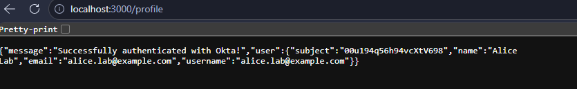
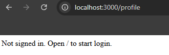

# Identity Security Lab

Hands-on lab exploring Okta and Microsoft Entra ID.

## Completed: Okta OIDC login

- Created Alice and Bob test users and the IAM-Lab-Users group.
- Registered a confidential OIDC web application in Okta.
- Built a local Node.js application using Express and openid-client.
- Implemented Authorization Code flow with PKCE, state, and nonce.
- Created an application session after successful authentication.
- Protected the profile endpoint against unauthenticated access.

## Verified tests

| Test | Result |
| --- | --- |
| Alice signs in through Okta and accesses her profile | Passed |
| A separate browser without an application session requests /profile | Access denied |

## Evidence

## Run locally

Requires Node.js and npm.

1. Open apps/okta-oidc.
2. Run npm ci.
3. Copy .env.example to .env.
4. Supply your own Okta issuer, client ID, active client secret, and random session secret.
5. Register this sign-in redirect URI in Okta:
   http://localhost:3000/authorization-code/callback
6. Assign your test users or group to the application.
7. Run npm start.
8. Open http://localhost:3000.

## Security and limitations

- Local learning environment, not a production deployment.
- Secrets belong in .env, which is excluded from Git.
- .env.example contains placeholders only.
- Sessions use an in-memory store and local HTTP cookies.
- Logout and production session storage are not implemented yet.
- Never publish client secrets, tokens, or authenticator enrollment QR codes.

## Planned exercises

- Logout and additional access-control tests
- SAML SSO
- SCIM provisioning and deprovisioning
- Explicit MFA policy configuration and testing
- Microsoft Entra ID and Conditional Access
